# 🗺️ Roadmap de Execução para Dupla (2 Pessoas · 9 Dias) — Projeto Paggo

> **Projeto:** Paggo — *"Seu dinheiro, simples de ver e fácil de planejar"*  
> **Evento:** Hackathon · Trilha 05 · Pagamentos & Finanças  
> **Documento Base:** Apresentação Oficial do Paggo (`Paggo_Apresentacao.pptx`)  
> **Metodologia:** Spec-Driven Development (Sistema Onion)  
> **Público & Personas:** Júlia (22 anos, jovem/delivery), Carlos (38 anos, metas/imóvel), Dona Lúcia (67 anos, boletos/acessibilidade).

---

## 👥 Divisão de Papéis da Dupla

```mermaid
graph LR
    subgraph P1 ["👤 Pessoa 1: Tech Lead / Back-end & IA"]
        P1A["API Node.js & Regras de Negócio"]
        P1B["Banco de Dados PostgreSQL"]
        P1C["Motor de IA: Plano & Assistente (Gemini)"]
        P1D["Segurança, LGPD & Deploy de Serviços"]
    end

    subgraph P2 ["👤 Pessoa 2: Product Lead / Front-end, UX & Pitch"]
        P2A["Interface React & Microinterações"]
        P2B["Linguagem Amigável ('O Paggo fala sua língua')"]
        P2C["Acessibilidade (Letras grandes, Daltônicos)"]
        P2D["Roteiro da Demo (Slide 4) & Pitch do Hackathon"]
    end

    P1 <--> |"Contratos de API & Sincronização Diária"| P2
```

---

## 📅 Cronograma dos 9 Dias (Passo a Passo)

```mermaid
gantt
    title Cronograma do Hackathon (2 Pessoas · 9 Dias)
    dateFormat  D
    axisFormat Dia %d
    
    section Bloco 1: Base & Login
    Setup, DB, OAuth e Onboarding UI :d1, 1, 2d
    
    section Bloco 2: Gastos & Dashboard
    Dashboard, Limites (Alerta 80%), Boletos :d3, 3, 2d
    
    section Bloco 3: IA & Cofrinho
    Cofrinho Interativo, Plano IA & Assistente :d5, 5, 2d
    
    section Bloco 4: Premium & Deploy
    Freemium, Acessibilidade e Deploy Nuvem :d7, 7, 1d
    
    section Bloco 5: Testes & Pitch
    Validação da Demo (Slide 4) e Ensaio do Pitch :d8, 8, 2d
```

---

### 🔹 BLOCO 1: BASE E LOGIN (DIAS 1 E 2)
> **Meta do Bloco:** Usuário entra no sistema (Google OAuth ou Demo) e completa o onboarding simplificado de 4 passos.

#### ☀️ Dia 1 — Setup, Estrutura e Identidade
- **Pessoa 1 (Back-end & DB):**
  - [x] Inicializar projeto backend Node.js (TypeScript, Express/Fastify).
  - [x] Provisionar banco PostgreSQL (local ou Supabase/Neon).
  - [x] Criar schema inicial: `User`, `Account`, `Category`, `Transaction`.
  - [x] Configurar variáveis de ambiente e `.env.example`.
- **Pessoa 2 (Front-end & UX):**
  - [x] Alinhar o branding do app com o nome **Paggo** e slogan *"Seu dinheiro, simples de ver e fácil de planejar"*.
  - [x] Adaptar a paleta visual e tipografia para a identidade do slide (azul/clean, dark mode).
  - [x] Estruturar tela de Boas-Vindas com storytelling da Júlia ("Para onde foi meu dinheiro?").
- 🤝 **Ponto de Sincronização (Fim do Dia 1):** Validação da conexão entre Frontend e Backend e revisão do schema do banco.

#### ☀️ Dia 2 — Autenticação Google & Onboarding Simplificado
- **Pessoa 1 (Back-end & DB):**
  - [x] Implementar autenticação via Google OAuth (ou mock funcional robusto para o hackathon).
  - [x] Criar endpoint `POST /api/onboarding` para salvar respostas iniciais do usuário.
  - [x] Regra de proteção LGPD: Criptografia de dados sensíveis; garantir que a IA nunca receba CPF ou dados identificáveis.
- **Pessoa 2 (Front-end & UX):**
  - [x] Implementar botão *"Entrar com Google"* na tela de login.
  - [x] Desenvolver o Onboarding interativo em 4 passos rápidos (Slide 3):
    1. **Entender:** Informar saldo e responder perguntas simples.
    2. **Visualizar:** Categorização automática prévia.
    3. **Controlar:** Definição inicial de tetos de gastos.
    4. **Planejar:** Definição da primeira meta de cofrinho.
  - [x] Adicionar atalho de 1 clique para Modo Demonstração (essencial para os jurados).
- 🤝 **Ponto de Sincronização (Fim do Dia 2):** Testar fluxo ponta a ponta: Login Google $\to$ Onboarding $\to$ Redirecionamento ao Dashboard.

---

### 🔹 BLOCO 2: GASTOS E DASHBOARD (DIAS 3 E 4)
> **Meta do Bloco:** Dashboard visual e humanizado com alerta de 80% de limite e controle de boletos/assinaturas.

#### ☀️ Dia 3 — Dashboard Humanizado & Categorização
- **Pessoa 1 (Back-end & DB):**
  - [x] Endpoints de métricas: `GET /api/dashboard/summary` (entradas, saídas, saldo restante).
  - [x] CRUD de transações com categorização automática (Alimentação, Lazer, Transporte, Casa, Saúde).
  - [x] Endpoint de evolução mensal de gastos.
- **Pessoa 2 (Front-end & UX):**
  - [x] Aplicar o dicionário de linguagem simples (*"O Paggo fala a sua língua"* - Slide 5):
    - Substituir *Fluxo de Caixa* por **"Quanto entrou e quanto saiu"**.
    - Substituir *Receitas* por **"Dinheiro que entrou"**.
    - Substituir *Saldo* por **"Quanto você tem"**.
    - Substituir *Rentabilidade Líquida* por **"Quanto sobrou"**.
  - [x] Montar visualização gráfica da distribuição de gastos em barras/pizza (Recharts).
- 🤝 **Ponto de Sincronização (Fim do Dia 3):** Conferir se os valores exibidos nos cards e gráficos batem exatamente com as somas do banco de dados.

#### ☀️ Dia 4 — Alerta de 80% de Limite, Assinaturas e Boletos
- **Pessoa 1 (Back-end & DB):**
  - [x] Criar lógica de monitoramento de tetos: calcular `spent / limit`.
  - [x] Trigger de alerta quando categoria atingir $\ge 80\%$ do teto.
  - [x] Endpoint de Boletos (com cálculo de dias para vencimento) e Assinaturas (custo mensal e projeção anual).
- **Pessoa 2 (Front-end & UX):**
  - [x] Implementar o card de alerta visual destacado no topo do Dashboard:
    - ⚠️ **"Delivery passou de 80% do limite (Sobrou R$ 420)"** (conforme Slide 1 e 4).
  - [x] Seção de Assinaturas: exibir quanto o usuário paga por mês e por ano (Slide 6).
  - [x] Seção de Boletos com badges contextuais (`Pendente`, `Vence hoje`, `Vencido há 2 dias`).
- 🤝 **Ponto de Sincronização (Fim do Dia 4):** Simulação de um gasto de delivery que dispara o alerta visual de 80% em tempo real na tela.

---

### 🔹 BLOCO 3: IA, COFRINHO E ASSISTENTE (DIAS 5 E 6)
> **Meta do Bloco:** Cofrinho interativo funcionando e os dois recursos de IA integrados (Plano de Ação e Assistente sem jargões).

#### ☀️ Dia 5 — Cofrinho Interativo & Motor de IA para Plano
- **Pessoa 1 (Back-end & IA):**
  - [x] Endpoints do Cofrinho: criar meta, consultar progresso e realizar aporte (`POST /api/piggy-bank/:id/deposit`).
  - [x] Integração com a API do Google Gemini (ou OpenAI):
    - Desenvolver prompt estruturado para o **Plano com IA**: recebe o saldo, despesas por categoria e a meta do cofrinho, retornando um plano de ação claro, com valores e prazos (ex.: *"Corte R$ 120 de delivery e você chega na viagem em outubro"*).
    - Higienização LGPD: Enviar apenas números e categorias para a IA, sem dados nominais.
- **Pessoa 2 (Front-end & UX):**
  - [x] Componente visual de Cofrinhos com metas temáticas (Viagem, Reserva de Emergência, Casa Própria).
  - [x] Interatividade de "Encher o cofrinho": botão de aporte rápido que deduz do saldo e anima o cofrinho enchendo.
  - [x] Botão de destaque no Dashboard: *"Gerar meu Plano com IA"*.
- 🤝 **Ponto de Sincronização (Fim do Dia 5):** Clicar em "Gerar Plano", aguardar a resposta da API do Gemini e exibir o plano formatado em cards de ação prática.

#### ☀️ Dia 6 — Assistente de IA Humanizado (Chat sem Termos Difíceis)
- **Pessoa 1 (Back-end & IA):**
  - [x] Endpoint de chat: `POST /api/assistant/chat`.
  - [x] System prompt com guardrails:
    - Persona do assistente: amigável, direto, proibido usar termos difíceis como "CDI", "EBITDA", "amortização", "fluxo de caixa".
    - Respostas curtas em linguagem coloquial acessível para a Júlia e para a Dona Lúcia.
- **Pessoa 2 (Front-end & UX):**
  - [x] Widget ou modal de chat flutuante do Assistente do Paggo.
  - [x] Sugestões de perguntas rápidas prontas em balões:
    - *"Posso pedir pizza hoje?"*
    - *"Quanto falta para minha meta da viagem?"*
    - *"O que acontece se eu atrasar meu boleto de luz?"*
- 🤝 **Ponto de Sincronização (Fim do Dia 6):** Enviar uma pergunta ao assistente e validar a resposta em tom empático e descomplicado.

---

### 🔹 BLOCO 4: PREMIUM, ACESSIBILIDADE E DEPLOY (DIA 7)
> **Meta do Bloco:** Trava de plano Grátis/Premium, recursos de acessibilidade ativos e aplicação hospedada na nuvem.

#### ☀️ Dia 7 — Modelo Freemium, Inclusão & Deploy
- **Pessoa 1 (Back-end & DevOps):**
  - [x] Implementar middleware com as regras Freemium (Slide 8):
    - **Grátis (R$ 0):** Até 3 limites, 1 cofrinho, 1 plano de IA/mês, 10 perguntas ao assistente.
    - **Premium (R$ 14,90/mês):** Limites ilimitados, IA ilimitada, histórico completo.
  - [ ] Deploy do Backend (Render / Railway / Fly.io) e Banco de Dados gerenciado. _(render.yaml pronto; pendente de credenciais)_
  - [x] Configuração de CORS, variáveis de produção e SSL. _(CORS por env com múltiplas origens; SSL vem do Render/Vercel)_
- **Pessoa 2 (Front-end, Design & Acessibilidade):**
  - [x] Modal/Banner de Upgrade para o Paggo Premium (R$ 14,90/mês). _(trava de cofrinho na aba Metas + aviso de cota da IA no modal do plano e no chat)_
  - [x] Barra de ferramentas de **Acessibilidade** (Slide 7):
    - [x] Alternador de Modo Escuro / Claro.
    - [x] Seletor de tamanho de fonte (Padrão / Grande para Dona Lúcia).
    - [x] Filtro/modo de alto contraste e cores para daltônicos.
    - [x] Suporte à fonte amigável para dislexia (OpenDyslexic / Lexend).
  - [ ] Deploy do Frontend (Vercel ou Netlify) conectado à API de produção. _(vercel.json pronto; pendente de credenciais)_
- 🤝 **Ponto de Sincronização (Fim do Dia 7):** Acessar o app em um link público HTTPS no celular e no computador e testar os recursos de acessibilidade.

---

### 🔹 BLOCO 5: TESTES E PITCH DO HACKATHON (DIAS 8 E 9)
> **Meta do Bloco:** Garantir que os 7 passos da Demo do Slide 4 funcionem sem falhas e o Pitch esteja impecável.

#### ☀️ Dia 8 — Roteiro da Demo e Testes E2E
- **Pessoa 1 & Pessoa 2 em Par (Trabalho Conjunto):**
  - [ ] Executar o checklist da **Hora da Demo (Slide 4)**:
    1. Entrar com Google (ou perfil demo de 1 clique).
    2. Responder o onboarding de 4 passos.
    3. Ver o dashboard com os gastos categorizados.
    4. Simular gasto que dispara o alerta: *"Delivery passou de 80% do limite"*.
    5. Clicar e gerar o plano prático da IA.
    6. Fazer uma pergunta no chat do assistente (*"Posso pedir pizza?"*).
    7. Fazer um aporte e ver o cofrinho encher.
  - [ ] Seed de dados perfeito: Criar uma conta pré-configurada com a história da Júlia (R$ 1.800 de salário, delivery estourando, meta de viagem para outubro).
  - [ ] Gravação de um vídeo de backup da tela (plano B contra instabilidade de Wi-Fi da banca).

#### ☀️ Dia 9 — Ensaio do Pitch, Slides e Entrega Final
- **Pessoa 1 (Suporte Técnico & Validação):**
  - [ ] Monitoramento dos logs da aplicação e banco de dados.
  - [ ] Preparar respostas para perguntas técnicas da banca: arquitetura (React + Node.js + PostgreSQL + Gemini), LGPD e custos de escala.
- **Pessoa 2 (Apresentação & Pitch):**
  - [ ] Ensaio do Pitch de 3 minutos:
    - **Minuto 1: O Problema** (História da Júlia, termos difíceis, planilhas cansativas).
    - **Minuto 2: A Solução & Demo ao vivo** (Os 7 passos da demo rodando no app).
    - **Minuto 3: Diferenciais, Modelo de Negócio e Acessibilidade** (Linguagem simples, Freemium R$ 14,90, inclusão de todas as idades, Open Finance futuro).
  - [ ] Submissão do link do repositório, link do app no ar e vídeo/slides na plataforma do Hackathon.

---

## 🎯 Matriz de Responsabilidade (RACI Simplificado)

| Entregável | Pessoa 1 (Back/IA) | Pessoa 2 (Front/Pitch) |
|---|:---:|:---:|
| Modelagem PostgreSQL & Endpoints | **Responsável** | Consultado |
| Integração Gemini (Plano & Chat) | **Responsável** | Informado |
| Segurança & Anonimização LGPD | **Responsável** | Informado |
| Interface React & Microinterações | Consultado | **Responsável** |
| Linguagem Amigável & Telas do App | Informado | **Responsável** |
| Barra de Acessibilidade (Idosos/Daltônicos) | Informado | **Responsável** |
| Deploy da Infraestrutura | **Responsável** | Colaborador |
| Apresentação & Pitch para a Banca | Colaborador | **Responsável** |

---

## 💡 Dica de Ouro para a Dupla

> *"No Hackathon, a banca avalia se o problema é real, se o produto funciona ao vivo e se a história convence. Mantenham o foco estrito no roteiro do Slide 4. Se a demo dos 7 passos rodar limpa e em menos de 2 minutos, o Paggo se destaca imediatamente na Trilha 05!"*
