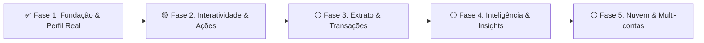

# 🗺️ Roadmap de Desenvolvimento — ConsumIQ

> **Aplicação:** ConsumIQ (`Paggo / consumo-inteligente`)  
> **Metodologia:** Spec-Driven Development (Sistema Onion)  
> **Última Atualização:** 22/11/2026  
> **Status Geral do Projeto:** v1.1.0 (MVP com Autenticação e Onboarding Realista Ativos)

---

## 🧭 Visão Estratégica

O objetivo do **ConsumIQ** é transformar o gerenciamento financeiro pessoal em uma experiência proativa, intuitiva e calibrada com a realidade financeira do usuário.

---

## 📊 Status das Fases de Entrega

| Fase | Escopo Principal | Versão | Status | Estimativa |
|---|---|:---:|:---:|:---:|
| **Fase 1** | Autenticação, Onboarding Financeiro Realista e Dashboard Base | `v1.1.0` | ✅ **Concluído** | 13 SP |
| **Fase 2** | Interatividade do Dashboard, Lançamentos Rápidos e Aportes | `v1.2.0` | 🟡 **Próximo (Sprint Atual)** | 8 SP |
| **Fase 3** | Módulo Completo de Transações e Extrato Avançado | `v1.3.0` | ⚪ **Planejado** | 8 SP |
| **Fase 4** | Inteligência Financeira e Motor de Insights | `v1.4.0` | ⚪ **Planejado** | 13 SP |
| **Fase 5** | Backend na Nuvem, Banco de Dados e Sincronização Multi-dispositivo | `v2.0.0` | ⚪ **Futuro** | 21 SP |

---

## 🚀 Detalhamento das Ações e Entregáveis

### ✅ Fase 1: Fundação, Autenticação & Perfil Realista (Entregue)
- [x] **Tela de Autenticação (`AuthPage`)**:
  - [x] Login por e-mail e senha.
  - [x] Registro de novo usuário com início automático de onboarding.
  - [x] Acesso rápido com perfil demonstrativo (1 clique).
- [x] **Assistente de Onboarding Financeiro em 5 Passos (`OnboardingWizard`)**:
  - [x] Passo 1: Informar receitas líquidas e rendas extras.
  - [x] Passo 2: Mapeamento de contas fixas e assinaturas recorrentes.
  - [x] Passo 3: Calibragem de limites reais por categoria com botão de recomendação automática.
  - [x] Passo 4: Definição de capacidade de poupança e metas de cofrinho.
  - [x] Passo 5: Validação do orçamento sustentável e ativação do perfil.
- [x] **Camada de Contexto e Persistência**:
  - [x] `AuthContext` com sessão salva em `localStorage`.
  - [x] `FinanceContext` com distribuição dinâmica das métricas para todo o app.
  - [x] Botão de Logout na barra lateral e personalização da saudação no Dashboard.

---

### 🟡 Fase 2: Interatividade do Dashboard & Gestão de Ações Rápidas (Sprint Atual)
> **Objetivo:** Permitir que o usuário realize operações financeiras diretamente no Dashboard sem precisar alterar o código ou recarregar a página.

- [ ] **2.1 Modal de Novo Lançamento Rápido (Receita / Despesa)**:
  - Adicionar botão flutuante ou botão de ação rápida no Header do Dashboard (`+ Nova Transação`).
  - Formulário com: Tipo (Entrada/Saída), Descrição, Valor, Data e Categoria.
  - Ao salvar, atualiza automaticamente o Saldo, o gráfico de evolução e o total gasto na categoria.
- [ ] **2.2 Interatividade de Cofrinhos (Aporte & Resgate)**:
  - Clicar em um cofrinho abre o modal de gestão.
  - Ações: `Adicionar Dinheiro` (deduz do saldo atual e soma no cofrinho) e `Resgatar Dinheiro`.
  - Atualização em tempo real da barra de progresso e percentual.
- [ ] **2.3 Baixa e Liquidação de Contas a Pagar (`BillsToPay`)**:
  - Ação de "Marcar como Paga" em cada boleto/fatura listada.
  - Mudança de status para `Pago` com registro da saída financeira correspondente.
- [ ] **2.4 Edição Rápida de Limites de Categoria**:
  - Permitir reajustar o teto de uma categoria com 1 clique (ícone de edição ao passar o mouse).

---

### ⚪ Fase 3: Módulo Dedicado de Transações (`/transacoes`)
> **Objetivo:** Implementar a segunda página anunciada na barra lateral ("Finanças > Transações").

- [ ] **3.1 Estruturação da Página de Transações (`TransactionsPage`)**:
  - Roteamento interno via estado ativo da `NavBar` ou React Router.
  - Visão em tabela moderna e responsiva com paginação ou scroll infinito.
- [ ] **3.2 Filtros e Pesquisa Avançada**:
  - Busca textual por descrição ou estabelecimento.
  - Filtro por período customizado (mês atual, últimos 3 meses, ano).
  - Filtro por categoria (Alimentação, Transporte, Lazer, etc.) e tipo (Entradas / Saídas).
- [ ] **3.3 Edição e Exclusão de Transações**:
  - Editar dados de uma transação lançada anteriormente.
  - Excluir transação com recálculo automático dos saldos.
- [ ] **3.4 Exportação de Relatórios**:
  - Exportação das transações filtradas para formato CSV e visualização para impressão/PDF.

---

### ⚪ Fase 4: Inteligência Financeira & Motor de Insights (`/insights`)
> **Objetivo:** Ativar a terceira seção da barra lateral ("Inteligência > Insights") com diagnósticos automatizados.

- [ ] **4.1 Painel de Diagnóstico Orçamentário**:
  - Cálculo de proporção de gastos: Necessidades Essenciais vs. Desejos/Lazer vs. Poupança (Regra 50/30/20).
  - Identificação de categorias com risco iminente de estourar o teto orçado.
- [ ] **4.2 Alertas Proativos**:
  - Alerta de boletos a vencer nas próximas 48 horas.
  - Alerta de gastos duplicados ou assinaturas recorrentes com aumento de preço.
- [ ] **4.3 Recomendações Personalizadas de Economia**:
  - Sugestões inteligentes: *"Se você reduzir 15% em Delivery neste mês, atingirá sua meta 'Viagem dos sonhos' 2 meses mais cedo."*
- [ ] **4.4 Simulador de Cenários**:
  - *"E se eu tiver um aumento de R$ 500?"* ou *"E se eu assumir uma parcela de R$ 300?"*

---

### ⚪ Fase 5: Nuvem, Persistência Remota & Multi-Dispositivo
> **Objetivo:** Tornar o ConsumIQ um produto SaaS escalável com sincronização entre celular e computador.

- [ ] **5.1 Arquitetura de Backend**:
  - API REST / GraphQL com Node.js/NestJS ou BaaS com Supabase/Firebase.
  - Banco de dados relacional (PostgreSQL) com migrações versionadas.
- [ ] **5.2 Autenticação Robusta**:
  - Tokens JWT, refresh tokens, login social (Google OAuth) e recuperação de senha por e-mail.
- [ ] **5.3 Criptografia e Segurança (LGPD / Compliance)**:
  - Criptografia de dados sensíveis em repouso e em trânsito.
- [ ] **5.4 Sincronização Offline-First**:
  - Suporte a PWA (Progressive Web App) para uso no smartphone mesmo sem internet.

---

## 📌 Guia de Execução Rápida

Para iniciar a execução da **Fase 2 (Interatividade do Dashboard)**:
1. Validar a especificação da feature: `/product-task "adicionar modal de nova transação e aporte em cofrinho"`
2. Iniciar o desenvolvimento: `/engineer-start interactive-dashboard-actions`
3. Executar as fases com qualidade e validação contínua: `/engineer-work`
